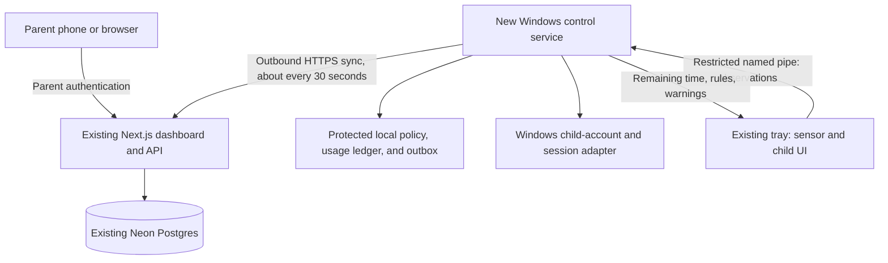

# Whole-PC screen-time enforcement on Windows 11 Pro

Design and implementation record, 15 October 2026, updated after the parent's clarification. The optional control service, secure API, and dashboard are implemented on `main`. Follow [the simple setup guide](START-HERE.md) to install and verify them. Installation defaults to monitoring; no accounts or deployed systems were changed during development. Native Windows sign-in enforcement remains subject to real-PC acceptance testing. The repository review below records the pre-implementation baseline; the implementation details are in [CONTROL-PROTOCOL.md](CONTROL-PROTOCOL.md) and the service README.

## Confirmed scope

The target is **Windows 11 Pro**. The parent wants **all app usage blocked once screen-time rules are crossed**, rather than restrictions on individual apps. Before a cutoff, the child can use their normal apps freely. After the cutoff, their Windows desktop remains inaccessible until the next allowed period or a valid parent grant. Signing back in, restarting the tray, rebooting, or disconnecting the internet must not reset the rule.

Use a single account-wide **Allowed / Blocked** decision. Do not add app allowlists, category filters, purchase controls, content filtering, browser restrictions, child request workflows, or VM administration to this implementation.

## Recommendation

Keep this repository's activity dashboard and visible Windows tray app. Add a small, machine-installed Windows service that evaluates screen-time rules locally and blocks the child's whole Windows session at cutoff. Reuse current active + media screen-time measurement for the daily limit, with optional allowed-hours rules and parent-granted extra time. Leave all apps available whenever the session is allowed.

For controls that a child cannot simply turn off using normal Windows permissions, use a **standard account for everyday use**, with a separate **parent administrator account** for machine changes. Microsoft explicitly recommends a standard child account for Family Safety; its family features may not work correctly when that account is an administrator. [Microsoft account/device guidance](https://support.microsoft.com/en-us/family-safety/how-to-connect-a-device-to-a-microsoft-account)

**Keeping the child as a host administrator is a supported design option, but makes these cooperative controls.** An administrator can change the machine's configuration and permissions, remove the service, or create another account. A SYSTEM service, file encryption, a watchdog, or hiding an uninstall button cannot establish a durable boundary against that administrator. Windows documents administrators as having complete system control. [Windows account types](https://support.microsoft.com/en-us/windows/security/identity-signin/manage-user-accounts-in-windows)

Do not require an enterprise domain, Entra enrollment, Intune, a second computer, or a subscription for the proposed custom design. Target the confirmed Windows 11 Pro PC. Confirm its build, existing account types, and any school management before implementing the enforcement adapter; Windows Home support is outside this scope.

## What is already implemented

Reviewed local `main` at `dcf11f0`, plus the two additional commits in the locally cached `origin/main` ending at `a07c77c`. No branch was pulled or checked out. This is a source review, not verification of the software currently installed on the child's PC or deployed in production.

| Area | Existing implementation | Implication |
| --- | --- | --- |
| Windows agent | .NET 8 tray application, version 1.6.0 at local HEAD; active/media/idle/locked classification every two seconds | Reuse the session sensor and UI |
| Reporting | Minute buckets, offline upload queue, app names, optional foreground browser titles, background media detail | Reporting is already substantial; keep it separate from enforcement accounting |
| Dashboard | Next.js on Vercel, Neon/Postgres, day/week/month views, apps, pages, sessions, overlaps | Extend this dashboard with device selection and actions |
| Reminders | Parent edits household-wide milestones; agent reads them at startup and every 15 minutes and caches them | These are notifications, not budgets or restrictions |
| Authentication | Password-only household login; signed session cookie; household-shared ingest HMAC key; explicit device allowlists when `HOUSEHOLDS` is configured | Useful monitoring foundation; add distinct parent and device identities before controls |
| Installation | Current-user Startup shortcut and files/configuration in `%LOCALAPPDATA%\ScreenTimeAgent`; no elevation | The monitored account owns and can alter the installation |
| Local autonomy | Tray offers Pause for 30 minutes and Exit | Controls cannot depend on this process staying alive voluntarily |
| Updates | User-confirmed download from public GitHub Releases; SHA-256 comparison against the downloaded manifest | This is a checksum, not a publisher signature; do not elevate this updater into SYSTEM |
| Cached newer work | `c0b356d` adds lifecycle events and version 1.7.0; `a07c77c` changes deployment ignores | Useful visibility; abrupt stops are inferred on the next agent start, not detected live by an independent service |
| Missing | No service, child Windows SID binding, control acknowledgments, enforced budgets/schedules, extension grants, or session restriction | These are the new architecture's scope |

Relevant source: [tray and polling](../agent/ScreenTime.Agent/MonitorContext.cs), [installer](../agent/install.ps1), [updater](../agent/ScreenTime.Agent/UpdateChecker.cs), [households](../dashboard/lib/households.ts), [request authentication](../dashboard/lib/auth.ts), [reminder API](../dashboard/app/api/agent/reminder-policy/route.ts), [database](../dashboard/lib/db.ts), and [dashboard queries](../dashboard/lib/summary.ts).

The dashboard currently selects the most recently reporting owned device, rather than offering an explicit device chooser. Hiding an app changes the display, not access to that app. Activity/page tables are scoped through application-level device allowlists, not database row-level security. Some older handoff documents describe earlier states: use current code as the authority.

## Accounts: maximum freedom with a clear boundary

| Identity | Recommended setup | What it permits |
| --- | --- | --- |
| Parent's cloud identity | Individual parent login with MFA or a passkey; household controller role | Set policy and grant time from the parent's own device |
| Parent's Windows account | Separate Administrator, protected by credentials/PIN the child does not have | Install, maintain, override, and recover the local service |
| Child's everyday Windows account | Standard user with their own password/PIN | Normal apps, games, browsers, files, personalization, and applications that support per-user installation |
| Service | Windows service identity, initially LocalSystem if required by the session-control adapter | Only fixed policy/accounting/session operations; no interactive sign-in |

For the custom agent, either a local Windows account or a Microsoft-linked Windows account can work: enrollment binds the Windows SID, not an email or Microsoft password. Microsoft Family Safety enrollment is not required by this design. The child keeps their own PIN; the service enforces access without knowing it.

Setup order:

1. Check **Settings → System → About** and **Settings → Accounts**. Record the child's existing account and SID during enrollment; identify other usable accounts.
2. Add or verify a separate parent Administrator account. Sign into it successfully and test elevation before changing the child's account type. Keep an offline recovery method accessible to the parent.
3. Preserve the child's existing profile. From the parent account, use **Accounts → Other users → Change account type** to make the child's daily account Standard; do not delete and recreate it. Sign the child out and back in, then verify their apps and saves. [Microsoft account-management instructions](https://support.microsoft.com/en-us/windows/security/identity-signin/manage-user-accounts-in-windows)
4. Leave preferred browsers and ordinary apps available. Preinstall the games, launchers, drivers, and tools that need machine elevation. Approve exceptional installs with the parent's credentials for that specific operation.
5. Install/enroll the machine service once with parent elevation. Select exactly which Windows SID belongs to the child. Parent and recovery accounts must never be restriction targets. The child keeps their own PIN; the system must work without knowing it.
6. Configure the daily screen-time limit and any allowed-hours rule in the existing dashboard. Enroll the device in monitoring mode first, verify parent recovery, and enable enforced mode only after the Windows acceptance tests pass.

Parent-approved elevation is still powerful: an elevated installer can change system settings. Avoid a generic “run any program as admin” shortcut or scheduled task. Temporarily making the child Administrator and removing that membership later does not undo changes or invalidate every already-running elevated process.

If full host administration matters more, keep the same separate parent/child accounts but label the device **Cooperative / administrator access**. Automatic cutoff can still execute while the service is running, but the child can disable or bypass it. Missing contact should be visible; it cannot prove whether the cause was deliberate, a network outage, sleep, or power loss. Giving the child a second host admin account they can access has the same limitation. Windows 11 Pro does not remove this tradeoff.

## Components and trust boundaries



### Cloud

- Keep Vercel and Neon. Store pending changes and acknowledgments durably in Postgres; do not depend on a web request, in-memory timer, or open browser staying alive.
- Parent authentication authorizes policy changes. Device authentication only permits that device to sync, report, and acknowledge. A telemetry credential cannot authorize extra time.
- Every action targets an explicit device and enrolled child SID/profile. Show the target before the parent acts; do not apply actions to whichever device reported last.
- Use short HTTPS polling with jitter. No inbound home-network port, remote shell, RDP, or always-on WebSocket server is needed. A useful initial online delivery target is 30–60 seconds, to be measured in testing.

### Windows service

- Add `agent/ScreenTime.Service` for startup, enrollment, synchronization, policy evaluation, protected accounting, session control, and acknowledgment. Keep privileged operations small and fixed.
- Install machine binaries in `%ProgramFiles%\ScreenTime` and state in `%ProgramData%\ScreenTime`, with explicit SYSTEM/admin write permissions. Restrict service stop/reconfigure permissions to administrators. Add service recovery and health reporting.
- Keep the device credential in the protected service context, absent from child-readable configuration and command-line arguments. A protected machine key is preferable; the initial implementation can use a per-device secret protected by ACLs and OS storage. Neither choice defeats a host administrator.
- Start/recover a non-elevated sensor in each enrolled interactive session. Determine SID/session from Windows, and authenticate named-pipe callers against that identity. Reject arbitrary file paths, executable launches, shell text, and policy writes through this pipe.
- Keep device synchronization running when the child is signed out, so a parent can grant access while the account is restricted.

### Existing tray

Retain foreground/media detection, aggregation, app naming, optional titles, and a visible status icon. Add remaining allowance, the next cutoff, advance warnings, and an explanation of what is collected. The service evaluates policy; the tray cannot change the budget or approve extra time.

Services run outside the user's interactive desktop. Keep foreground/media observation and UI in the user's session, communicating with the service through authenticated IPC. [Microsoft interactive-service guidance](https://learn.microsoft.com/en-us/windows/win32/services/interactive-services)

The child's own session process remains lower trust: they can terminate it and potentially falsify observations. Service protection does not make app names or active/media classifications tamper-proof. Detect sensor loss, attempt recovery, and explicitly mark missing/estimated data. For stricter accounting, count the unlocked child session conservatively while the sensor is absent.

In managed mode, the existing Pause/Exit semantics need an explicit UX change: pausing title/detail collection or closing the tray must not silently suspend time rules. Clearly show that the parent-installed service continues. Keep the existing fully voluntary behavior in monitor-only mode. Do not make the agent hidden.

## Cutoff behavior and policy semantics

| State | Child's experience | Transition |
| --- | --- | --- |
| Allowed | Normal use of all apps | Service continuously evaluates the local budget and schedule |
| Warning | Normal use continues; warning shows the known cutoff | Warn five minutes and one minute before cutoff when possible |
| Blocked | Child's Windows desktop/apps cannot be used | At cutoff, gate sign-in and end existing child sessions; retain the restriction across restart |
| Allowed again | Child can sign in and launch apps normally | Next allowed window/day with available budget, or a valid parent grant |

Connectivity and sensor health are separate status indicators. Losing either must not itself change Blocked to Allowed. Warning is an allowed state, not extra time after the limit.

| Action | Intended behavior |
| --- | --- |
| Add 15/30/custom minutes | One grant ID, assigned to the current policy day, applied once; expires at the configured boundary |
| Set daily budget | Per child/device daily allowance; explicitly select the accounting basis |
| Set bedtime/allowed hours | Locally evaluated weekly schedule in the parent's configured timezone |
| Allow until a time | A bounded override that explicitly identifies which rules it overrides; default does not extend bedtime |

Use **whole-account** rules throughout this scope. Every app becomes unavailable together, including browsers, games, and already-running applications. App names and dashboard categories remain reporting detail; no executable matching, process kill list, or app exemption is needed.

Budget accounting must distinguish:

- **Actual use (initial basis):** current active + media metric. Preserve the screen-time definition already used by this repo. Move the allowance ledger into the service and use a conservative unlocked-session fallback if the sensor disappears. User-session observations remain lower trust; this is not unforgeable activity measurement.
- **Unlocked session time:** service-observed time during which the child can use the desktop, including idle time. More conservative and suited to an enforceable daily cap after Windows validation.

Do not call these the same number. Enforce the selected daily budget, rather than leaving it as a reminder. Expose unlocked-session accounting as a stricter optional basis. Page-title rows and overlapping background media never add extra quota consumption. Dashboard display filters cannot change quotas. The service owns the cutoff decision; it does not wait for the next cloud upload or a dashboard calculation.

Represent policy as a complete signed desired-state snapshot containing:

```text
schemaVersion, householdId, deviceId, childId, windowsSid, revision,
issuedAt, timeZone,
mode: monitor | cooperative | managed,
dailyBudgetSeconds?, budgetBasis: actual_use | unlocked_session,
weeklyAllowedWindows, warningOffsetsSeconds: [300, 60], cutoffGraceSeconds: 0,
effectiveAt, grants[], overrides[], offlineBehavior
```

Use `Asia/Jerusalem` as the initial family timezone, with an explicit Windows timezone mapping. Compute local days/DST transitions from this policy, not the child's selected timezone. Existing reminder state currently uses the PC's local date and must not become the enforcement ledger unchanged.

Evaluate in a documented order: valid explicit rule overrides, allowed-hours boundary, then budget. An ordinary extra-time grant changes the budget only; it does not extend bedtime. Every decision reports its reason. Policy updates can cancel a pending restriction before it executes. Warn before a known deadline and block at it, with no default post-cutoff grace. If a new policy reduces the limit below usage already consumed, its explicit `effectiveAt` determines cutoff; a parent can choose a short save window as part of that change. Persist each effective deadline so reboot, sign-in, sensor restart, and reconnect cannot renew it.

## Whole-session restriction: the Windows implementation gate

`LockWorkStation` is a courtesy action, not a lasting restriction: the child can unlock with their own credentials. It must be invoked from an interactive desktop. Disconnecting a session also leaves it available for reconnection. [LockWorkStation](https://learn.microsoft.com/en-us/windows/win32/api/winuser/nf-winuser-lockworkstation), [session administration](https://learn.microsoft.com/en-us/windows/win32/termserv/terminal-services-administration)

For the custom **managed** backend, prototype this account-scoped strategy before enabling it for family use:

1. Show warnings before cutoff. Re-evaluate the latest policy at the effective deadline; no additional five minutes is awarded after a known limit is reached.
2. Use a dedicated product-owned local restriction group, identified by its saved group SID. Assign console deny (`SeDenyInteractiveLogonRight`) and remote-interactive deny rights to that group; toggle membership for the exact enrolled child SID. Reject an unexpected same-name group rather than adopting it. Persist desired Blocked state and a recovery journal before changing membership, then verify membership and both deny-right assignments. This isolates the product's restriction from externally imposed account rights. [Windows account rights on users and groups](https://learn.microsoft.com/en-us/windows/win32/secauthz/account-rights-constants)
3. End every existing interactive session for that child SID using `WTSLogoffSession`, and verify no matching usable session remains before acknowledging Blocked as applied. A sign-in restriction affects the next logon; it does not terminate an existing session. Signing out can lose unsaved work, so this behavior must be visible before enabling managed enforcement. [Deny local logon](https://learn.microsoft.com/en-us/previous-versions/windows/it-pro/windows-10/security/threat-protection/security-policy-settings/deny-log-on-locally), [session operations](https://learn.microsoft.com/en-us/windows/win32/termserv/terminal-services-administration)
4. Remove the child SID from this product's restriction group when the schedule/day reset and remaining budget permit access, or a valid parent grant/override does so. If several rules block access, all applicable restrictions must be satisfied or explicitly overridden. A parent recovery tool can restore access locally without network access. Leave externally imposed account rights and group memberships untouched.

This is a proposed use of Windows primitives, **not a verified Family Safety equivalent**. Validate Microsoft/local accounts, Windows Hello, console/RDP sign-in, disconnected sessions, fast user switching, reboot, and policy restoration on the target Windows 11 Pro build. Inspect school/domain policy conflicts. Never deny broad groups such as Users or Everyone, add parent/recovery SIDs to the restriction group, disable the parent account, or change the child's password. [Native account-rights API](https://learn.microsoft.com/en-us/windows/win32/api/ntsecapi/nf-ntsecapi-lsaaddaccountrights)

This backend **signs the child out and closes their apps**; it does not preserve an open game/document behind a normal lock screen. Advance warnings provide save time. A requirement to preserve running apps would require a different, separately validated session-gating backend; do not silently substitute a dismissible overlay or repeated lock calls.

Measure the boot/first-logon race: a restricted window may begin while the PC is off, before the service has changed membership. Automatic service startup alone does not prove that initial sign-in is gated. Document any bounded access before reconciliation, and do not advertise instantaneous cutoff or zero startup access unless testing establishes it.

If this adapter fails its Windows acceptance tests, ship cooperative controls and retain native Family Safety for hard restrictions until the adapter is corrected. Do not describe repeated locking or a fullscreen overlay as reliable enforcement.

Microsoft Family Safety is also a practical immediate option for native limits while this repo continues reporting. Its documented control surface is its app/site; this design does not assume a supported public automation API. Do not build around private endpoint scraping. Select one enforcement owner per rule/device so Family Safety and the custom service do not independently block and grant conflicting allowances. Their usage counters may differ.

## Delivery, security, and failure behavior

### Protocol and storage

Add these conceptual endpoints, following the repository's existing Next.js route conventions:

| Endpoint | Caller and purpose |
| --- | --- |
| `POST /api/enrollment-tokens` | Parent creates a short-lived, one-use, household-bound enrollment token |
| `POST /api/agent/enroll` | Elevated installer redeems token and registers device credential/public key and child SID |
| `PUT /api/devices/{id}/policy` | Authorized parent creates an immutable revision with an expected-current-revision check |
| `POST /api/devices/{id}/actions` | Authorized parent creates a grant or bounded override; generate a policy revision transactionally |
| `POST /api/agent/sync` | Device exchanges heartbeat, last applied revision, enforcement acknowledgments, and the current signed desired state |

Add tables for devices/credentials, device-child-SID bindings, immutable policy revisions, grants/overrides, action delivery, device status, and audit events. Retain existing household ownership and strengthen parent authentication. All new records carry household and device scope; use foreign keys/uniqueness and database-enforced tenant boundaries. Retain activity tables while migrating ownership through an explicit device registry. Replace request-time schema mutation with versioned migrations for control data.

Use parent authentication with revocable sessions, login rate limits, same-origin/CSRF protection, and server-side authorization on every control route. The tray is read-only for policy and allowance. Parent Windows credentials and Microsoft account passwords never go to this service/API.

Replace household-shared agent keys with independently revocable per-device credentials. Bind device requests to protocol version, HTTP method, canonical path, device ID, timestamp, nonce/sequence, and body hash. Reject replays with transactional nonce/sequence storage. Check ownership and revocation on every request. The current ten-minute timestamp window and telemetry upserts are not sufficient for granting time or executing actions.

Sign desired policies with a separate server policy-signing key; devices hold verification keys only. Include target, schema version, and monotonically increasing revision. Persist the highest accepted revision and reject rollback or wrong-target snapshots. Recurring rules remain authoritative until superseded; grants, overrides, and immediate actions carry explicit expiry. Define an authenticated signing-key rotation path before deployment.

Use unique action/grant IDs and durable local receipts. Retrying sync cannot grant another 30 minutes. A new revision supersedes pending older restrictions. Expired grants/overrides cannot apply hours after reconnect. The dashboard distinguishes **queued, received, applied, rejected, expired**, and shows the last confirmed revision and Allowed/Blocked state; “HTTP request accepted” is not “child session restricted.”

### Offline and recovery

| Condition | Required behavior |
| --- | --- |
| Internet/cloud unavailable | Enforce the last valid saved schedule locally and preserve the allowance ledger; queue reports. New parent instructions remain pending |
| Device asleep/off | Show last contact and pending delivery; do not claim a new rule or parent grant was applied |
| Sensor missing | Service retries startup, marks detail unavailable, and uses the selected conservative accounting fallback |
| Reboot/service restart | Restore quota and policy revision, then reconcile the current boundary; no fresh allowance from restarting |
| Clock/timezone changes | Use monotonic elapsed time while running and protected UTC/server anchors across restarts; timezone changes do not mint another day. Mark untrusted time and apply a bounded recovery rule |
| Prolonged offline use | Keep recurring schedules/budgets until authenticated replacement or local parent recovery. Temporary grants/overrides expire at their stated boundaries. Going offline does not disable the base rules |
| Service/update failure while account is denied | Explicitly recognize that restriction-group membership persists even if the service dies. Use service recovery plus the parent's independent local recovery tool/account; automatic expiry/unrestriction is evaluated only when recovery code runs |
| Parent needs access | Parent/recovery SID is excluded from target selection and remains usable offline; recovery restores only this product's changes |

Persistent time trust across an offline reboot is imperfect; do not promise clock-tamper resistance against an administrator. Missing heartbeat indicates unreachability, not proof of misconduct. Optional notifications should trigger on meaningful changes, rather than every missed poll.

Version one targets one child on one PC. A future shared budget across multiple offline devices needs server-allocated per-device allowance leases; otherwise both devices can spend the same remaining minutes. Do not advertise a global offline cap until that is implemented.

## Privacy and privileged updates

Continue avoiding screenshots, keystrokes, URLs, page bodies, microphone/camera data, and file contents. Control does not require browser titles; offer detail collection separately and recommend titles off unless the family wants them. Keep rules, reasons, and remaining time visible to the child. Add retention/deletion controls; proposed defaults are 30 days for detailed activity and 90 days for control audit events.

For the new privileged service, use a parent-approved elevated installer initially. Automated privileged updates require authenticated/publisher-signed packages, an authenticated versioned manifest, protected staging, signature/target checks, rollback prevention, and recoverable installation. Keep software-update signing authority separate from ordinary parent policy authority. Never run the existing child-writable temporary PowerShell updater as SYSTEM or accept an arbitrary package URL through a control action. The current voluntary tray updater can remain for monitor-only installations.

If native hardening against offline disk modification is needed, treat Secure Boot, disk encryption, recovery-key custody, and physical/reinstallation access as a separate setup decision. This design does not promise resistance to OS reinstall or alternative boot, and it does not depend on preventing the child from learning Windows administration.

## Implementation order and acceptance

1. **Preserve and reconcile the baseline.** Review the cached upstream lifecycle changes before implementation. Keep existing reporting and the 40 currently passing dashboard tests. Add an explicit device chooser and child SID enrollment.
2. **Build identity and desired state.** Parent roles/authentication, per-device keys, versioned policies, typed actions/grants, transactional delivery/audit, and authorization/replay tests. Devices advertise capabilities so old monitoring-only agents cannot appear controllable.
3. **Add the service and child interface in monitoring mode.** Protected installation/IPC, polling, independent heartbeat, warnings, remaining time, receipts, recovery, and offline persistence. Exercise the protocol without destructive session actions.
4. **Prototype managed restriction on a Windows test account.** Validate sign-in gating plus logoff, every recovery path, and standard-user tampering before allowing the parent to enable it for the child's account. Keep a working parent login throughout.
5. **Enable whole-PC cutoff.** Daily budget and configured allowed-hours rules block all apps together; a parent grant or the next valid window restores sign-in. Reuse actual-use accounting with the documented missing-sensor fallback and optional stricter unlocked-session basis. App-specific blocking and child request workflows remain outside scope.

Required evidence before calling managed mode reliable:

- Wrong household/device/SID and child-role attempts cannot change policy; old/replayed/wrong-target/expired messages are rejected; retrying a grant consumes it once.
- No device credential is readable by the child; IPC cannot perform arbitrary privileged operations; a standard user cannot stop/reconfigure/replace the service or edit policy/ledger.
- Killing the tray, signing out, rebooting, losing network, locking/unlocking, sleeping, switching users, and changing time cannot silently reset allowance or renew grace periods. Measure the boot/first-logon enforcement gap and verify the selected schedule after reconciliation. Verify both actual-use uncertainty and stricter accounting behavior.
- Password, PIN/Windows Hello, remote sign-in where supported, and existing disconnected sessions respect a restricted child SID. Parent and recovery accounts continue to work.
- A delivered action produces verified OS state and an acknowledgment. Failed/partial enforcement remains visible as failed/partial; restriction expiry and rollback restore access.
- Warnings before cutoff, unsaved-work behavior, signed-out granting, service crash during restriction, failed update, uninstall restoration, and offline local recovery are exercised on Windows. Verify that already-running apps are closed by sign-out and that no app can be used through a remaining child session.

Review validation: the existing dashboard test suite passed **40/40** during this architecture review. Those tests cover current data transformations and reminder parsing, not the proposed control plane. No Windows build, account change, service installation, or enforcement test was performed from this macOS workspace.
